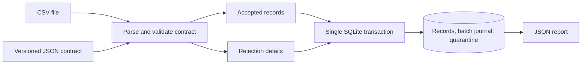

# Contract Pipeline

A local data ingestion tool that validates CSV records against a versioned JSON contract, loads valid rows into SQLite, and records rejected rows with specific errors. Content hashes make file replay idempotent; record keys support updates across different batches.

**Status:** My implemented local portfolio project. All supplied records are fictional retail orders. See [engineering and interview notes](ENGINEERING.md).

## Quick start

Prerequisites: Python 3.11 or newer with SQLite. No external packages, account connections, credentials, or environment variables are required. Run these commands from the project folder; substitute `python3` if needed.

```sh
python --version
python demo.py
python -m unittest discover -s tests -v
```

The isolated demo imports six synthetic rows: three are accepted and three are rejected. Replaying the same file is skipped and the warehouse still holds three records. Temporary demo databases are cleaned up automatically.

For a persistent warehouse:

```sh
python pipeline.py --db var/warehouse.db ingest examples/orders.csv --contract examples/orders.contract.json --dry-run
python pipeline.py --db var/warehouse.db ingest examples/orders.csv --contract examples/orders.contract.json
python pipeline.py --db var/warehouse.db ingest examples/orders.csv --contract examples/orders.contract.json
python pipeline.py --db var/warehouse.db report
```

The last import prints `"skipped": true`. `--strict` rejects an entire file if any row is invalid and makes no warehouse changes. Default mode commits accepted records and rejection details together. Row rejection in default mode is a reported data-quality result, not a process failure; the command exits 0. Structural errors, strict rejection, and storage failures exit 2.

## Contract format

See [`examples/orders.contract.json`](examples/orders.contract.json). A contract has a versioned `name`, a required string `key`, and named `fields`. Supported types are string, integer, decimal, and ISO date. `required`, numeric `min`, and string `enum` constraints are supported. Unknown constraints are rejected. Headers may be reordered but must contain exactly the required field names with no duplicates or extra columns.

The first occurrence of a key reserves it within a file, even if another field is invalid. Later occurrences are rejected. Across different files, an accepted record updates the stored record with the same key; an invalid update never overwrites a previously valid record. Last successfully committed batch wins. There is no event-time ordering or automatic deletion of records absent from later files.

## Architecture



## Storage and configuration

`--db` chooses the database. The warehouse uses fixed SQL tables with JSON record bodies; user-provided field names are never interpolated as SQL identifiers. Decimal values are stored as strings to preserve exact decimal values. The batch journal and quarantine retain lineage for imports; accepted historical record versions are not retained.

No `.env` file is required. `var/` and database files are ignored. Quarantine contains source values, so use only the supplied synthetic examples in public demonstrations. Real input data and local warehouses should remain private.

## Verification

Tests cover valid and invalid records, replay, key updates, exact decimals, preservation of good records, schema changes, malformed files, dry run, strict mode, and transaction rollback after an injected storage failure. The included GitHub Actions workflow still needs a remote run after publication.

## Limitations

Files are validated in memory with a 20 MiB limit. The tool is a batch demonstration, with no scheduler, cloud connector, streaming ingestion, SQL analytics UI, authentication, or schema migration engine. Renaming a changed contract creates a separate namespace; migrating old data requires an explicit process. Input dates carry no time zone because they are calendar dates. The sample counts are fixture results, not business impact or performance measurements.

## Connect

[LinkedIn — Abhijith Viswanathan](https://www.linkedin.com/in/abhijith-viswanathan-0a7216436/)

## Development notes

AI tools assisted with implementation, tests and documentation. This is my personal portfolio work; benchmark results and deployment boundaries are documented in the repository.
